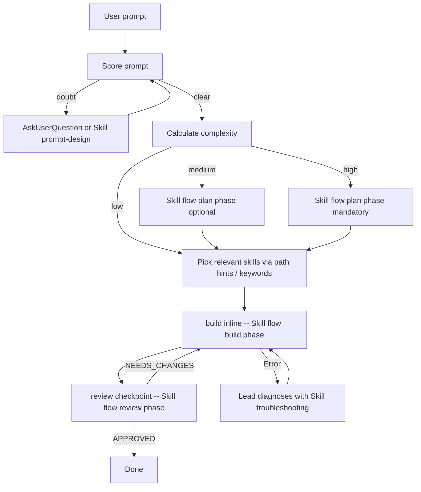

# System inventory & operational detail

On-demand reference. CLAUDE.md keeps only always-needed behavior; everything here is data, history or detail recoverable with a Read. Counts carry their own snapshot dates; recount before relying on one.

## Sync working model (full detail)

The intended normal case is working in **another** project while poneglyph runs underneath through `~/.claude/`. Install once per machine:

```bash
bun .claude/commands/sync-poneglyph.ts --execute --backup --force
```

- Links `skills/commands/rules/docs/hooks/output-styles/scripts` into `~/.claude/` (authoritative folder list = `LINK_FOLDERS` in `scripts/sync-claude.ts`; rules link per-entry, with `test-policy.md` excluded from the global layer) (junctions on Windows, no admin; symlinks on macOS/Linux) and regenerates `~/.claude/settings.json` from `settings.global.json` deep-merged with `settings.machine.json` (gitignored, per-machine; hook groups are unioned per event and de-duplicated by matcher and command, so the overlay only adds machine-specific handlers), then validates the result with `claude doctor` ("Invalid settings" section); a rejected file fails the sync and the backup is restored.
- **macOS**: also create `.claude/settings.machine.json` carrying that machine's `env.PATH`: the GUI app launches with a minimal PATH, so linking alone leaves hooks/statusline broken; the PATH overlay fixes it (separate cause from linking).
- **Scope boundary**: the global (`~/.claude/skills`, link → repo) and project (`./.claude/skills`, real) paths expose the same skills, which Claude deduplicates by name. Only the user profile registers hooks; `.claude/settings.json` is hook-free, so a Poneglyph maintenance session cannot double-fire them.
- Settings load at session start → a fresh sync takes effect on the NEXT session.
- **Preserve machine plugin activation in the ignored overlay**: `claude plugin install` / `marketplace add` update `~/.claude/settings.json`, which the next sync regenerates. Shared defaults belong in `settings.global.json`; private opt-in and its marketplace belong in `.claude/settings.machine.json` under `enabledPlugins` and `extraKnownMarketplaces`. Install the reviewed private addon once per opted-in machine and verify its actual cache revision. Work exposes unique skills and private memory; its retired SessionStart hook must not remain in the installed cache.
- **Windows**: `CLAUDE.md` is **copied**, not linked (junctions can't link files) → re-run the sync after editing it or the global copy goes stale. On macOS it is a symlink (verified 2026-06-10).

## System-prompt channel (multi-host)

**`.claude/output-styles/poneglyph.md` is the communication-law SSOT**: the primary document, edit THIS one; Claude Code reads it live through the folder symlink. It names no person ("the user"), so it can be reused. Contents: header (busy-lead brief) / Truth / Glance (order: short answer first, detail if it adds, optional `Aviso:` line, closing `ROBIN:` line with summary + next step, also the degradation canary logged by `security-gate.ts`) / Voice / Cost / References (Spanish codes: D decisiones · O opciones · H hallazgos · R riesgos · P preguntas · A acciones) / Limits (proactive in words, not in actions) / Examples (5 pairs). Prompts to other models follow `prompt-design` Context 3, and delegation and consultation prompts carry a `[REPLY FORMAT]` line so Codex/Grok answer the Lead in plain English. `system-prompts/poneglyph-sp.md` is the body-only twin **GENERATED by sync-claude** (frontmatter stripped, no marker, clean body) consumed by the grok symlink, sync-codex's concat, and compare.ts; never edit it by hand; after editing the style, re-run sync-claude (twin) + sync-codex (AGENTS.md). Compare harness: `.claude/evals/compare.ts` (presets + `--probes` adherence battery).

**Evidence dossier (2026-08-18)**: style = surgical system-prompt edit, adherence ≥ append (Anthropic maintainer ranking in issue #10671 puts `--append-system-prompt` weakest; deprecation attempted and reversed "indefinitely"); our probe battery 4/4 both channels; dupe = innocuous but useless (+~10K input/session); size 25-500 lines has NULL adherence effect and the real degrader is within-session decay, ~-5.6% odds per generated function (arXiv 2605.10039); subagents inherit NEITHER channel (forks do).

| Host | Channel | Freshness | Install / verify |
|---|---|---|---|
| Claude Code (any model) | `outputStyle: "Poneglyph"` (settings, always-on), the PRIMARY channel. `--append-system-prompt-file <sp>` is measurement/belt only | live | Adapter regenerates on every `sync-claude --execute`. Known gaps: VS Code extension may not load custom styles (#39331); subagents don't inherit |
| Codex / OpenAI | `$CODEX_HOME/AGENTS.md` is generated from CLAUDE.md, the style twin and shared runtime contract. Core skills are linked; command entrypoints and native hooks are generated. Account links to matching doctrine are preserved. The adapter retains its 32 KiB instruction budget. | Re-sync changed sources; update a shared target before linked profiles. Native hooks need `/hooks` trust. | `bun .claude/scripts/sync-codex.ts --execute --backup --force` |
| Grok Build | Claude compatibility supplies doctrine, rules, skills and commands. The generated style twin is installed once. Inherited Claude hooks remain disabled; native hooks adapt the shared logic. | Links are live; Windows copies require sync. Inspect native discovery separately. | `bun .claude/scripts/sync-grok.ts --execute --backup --force`; verify with `grok inspect` |

**Claude Code wrapper** (manual launches; optional):

```bash
# zsh (~/.zshrc)
claude() { ~/.local/bin/claude --append-system-prompt-file \
  "<repo>/.claude/system-prompts/poneglyph-sp.md" "$@"; }
```

```powershell
# PowerShell ($PROFILE)
function claude { & "$env:USERPROFILE\.local\bin\claude.exe" --append-system-prompt-file `
  "<repo>\.claude\system-prompts\poneglyph-sp.md" @args }
```

**A/B comparator** (run OUTSIDE a sandboxed session): `bun .claude/evals/compare.ts "<prompt>" [--preset sp|stock|style-vs-sp|dupe] [--runs N] [--tools] [--dry-run]`. `stock` uses `--bare` (whole layer off) and needs `ANTHROPIC_API_KEY`. Markers are descriptive per side, never a suite verdict.

## Entry points → how each routes to the workflow & skills

Poneglyph has ONE flow (the 5 phases + Lead turn flow); what differs is how you enter it. Skill activation is **layered** and the entry point decides which layers fire:

| Entry point | What it is | Phase routing | Skill activation |
|---|---|---|---|
| **Plain prompt** (`haz X`) | Normal turn | Lead triages complexity → invokes phase skills / `/flow-lifecycle` as needed | `prompt-router.ts` suggests skills (async, cheap model) **+** Lead self-matches via `agent-routing §05` on non-trivial work |
| **`/flow-lifecycle <task>`** | The **router**, feature lifecycle orchestrator | Deterministic: triages mode → runs phases 1-5 with hard gates, **invoking each phase skill explicitly** | Wired by `/flow-lifecycle` itself (phase→skill is hard-coded in the command); hook skips `/flow-lifecycle` (no double-routing) |
| **`/goal <condition>`** | Built-in **persistence loop** (Stop hook), keeps the Lead working until the condition holds. NOT a router | None by itself, the Lead routes each turn via the always-loaded CLAUDE.md core | Hook skips it (like every slash command). `/goal` runs as the **Lead**, not a fresh-context agent: it already has the always-loaded routing core and can invoke any `Skill()` itself; it needs no injected hint. Whether the Lead *actually* loads the relevant skill on a work turn is a discretionary call (no enforcement); for guaranteed skill use, wrap the work in `/flow-lifecycle` |
| **`/expert-role <name>`** | Persona-framing over existing skills | Composes skills for the role; Lead still triages | Hook skips it (role self-composes); Lead matches within the persona |

**The honest answer to "siempre activar las skills":** activation is layered:
1. **Routing core is always-loaded** (CLAUDE.md §How to work + §Agents and skills). The Lead therefore triages and routes on EVERY turn, including every `/goal` loop turn, without any hook. This is the real "always-on" layer.
2. **`/flow-lifecycle` → deterministic phase→skill wiring** (each phase invokes its skill explicitly). The strongest guarantee, for feature-shaped work.
3. **Prompt router → per-prompt skill candidates**, best-effort and async: a cheap model reads each plain prompt against the whole catalog (`prompt-router.ts`) and the Lead answers every candidate in a `Router:` line. NOT a guarantee (the note can arrive late, and the Lead may answer no).

**The real gap (named honestly):** skill *use* by the Lead is discretionary: the router only proposes, CLAUDE.md only says "match skills before build", and the Lead can (and does) skip both on a given turn. On conversational/meta turns skipping is correct (loading a skill would be ceremony); the concern is genuine work turns. **The only deterministic enforcement of skill use is `/flow-lifecycle`** (each phase invokes its skill explicitly). So: for a real feature, wrap it in `/flow-lifecycle` even from inside a `/goal` loop. Don't try to force skill use via hooks/always-loaded: that's the regression pattern (Cmd IX: always-loaded content costs every turn).

## Lead turn flow



Canonical per-turn checklist: `agent-routing` skill §1.

## Execution modes

| Mode | When | Cost |
|------|------|------|
| **Inline** (default) | Build/write by default | 1x |
| **Parallel read-only agents** | ≥4 independent read-only units in one message (research sweeps, decision-review panels); `Workflow` is denied | scales w/ agent count |
| **Parallel write agents** | explicit user opt-in only ("ultracode" / direct ask); per-unit `isolation: 'worktree'` on collision | scales |
| **Tiered** | Medium complexity with 2-3 domains sharing interfaces, contracts inline via `flow` (plan phase) Mode B | ~2x |
| **Team agents** (experimental) | High complexity, 3+ independent domains, interface negotiation, `CLAUDE_CODE_EXPERIMENTAL_AGENT_TEAMS=1` | 3-7x |

> **Background sessions / agent-view** (`claude agents`, CC ≥2.1.139, version-specific, verify): orthogonal axis: runs whole **sessions** in the background with a dashboard for running/blocked/done. `claude --bg` / `←←` to background; `/resume` lists them. Operational tool, not a per-turn routing mode.

## Planner adaptive levels (`flow` plan phase)

The plan phase declares `Level: Quick|Standard|Full — <reason>` on its first line and escalates
on uncertainty, never splicing levels. The table and the references each level loads have one
owner: `skills/flow/references/02-plan.md` §Step 1. (There are no `/flow-lifecycle`
`minimal|standard|full` modes; every phase runs and a justified skip
is announced and recorded.)

## Skill loading into a spawned agent (3 mechanisms)

1. **`skills:` frontmatter** preloads full SKILL.md at spawn, for a custom `agentType` that ALWAYS needs a skill.
2. **`Skill` tool**: an agent whose `tools:` include `Skill` self-invokes task-specific skills mid-task (CC ≥2.1.133). Name the relevant skills in the task prose.
3. **Arch H: Lead-Directed Skill Reads** (fallback): embed up to 3 `Read .claude/skills/<name>/SKILL.md` instructions in the `[RELEVANT SKILLS FOR THIS TASK]` block. Lead-side `Skill()` does NOT propagate to spawned agents.

Full template and propagation model: `agent-routing/references/06-context-arch-h.md`.

## When to use rules vs skills (project level)

| Content type | Mechanism | Why |
|---|---|---|
| **Constraint**: violation blocks merge, must ALWAYS be visible | **Rule** (always-on) | e.g., "features cannot import from other features" |
| **Knowledge/guidance**: useful when relevant, not every prompt | **Skill** (on-demand) | e.g., naming conventions, function design patterns |

Test: "does the agent need this in EVERY prompt?". No → skill.

## When to use a command vs a skill (same layer, different trigger)

**Default to a skill.** Reach for a command only for (a) a script entrypoint (`sync-poneglyph.ts`) or (b) a pure prompt-macro that orchestrates skills with `$ARGUMENTS`/`allowed-tools` (`flow-lifecycle`, `expert-role`). Commands and user-invocable skills can accept arguments. Model invocation depends on host policy and skill metadata; keyword hints are advisory. Live commands: `flow-lifecycle`, `expert-role`, `sync-poneglyph`; everything else is a skill.

## Component inventory

| Component | Current | Detail |
|---|---|---|
| Agents | **1 generated agent (prompt-router)** | no other agent files; work runs inline (delegation doctrine), read-only fan-out via parallel `Explore`/`general-purpose` agents. The ONE sanctioned single-agent dispatch is the review's fresh-context reviewer (P1 exception), ad-hoc, no agent file |
| Skills | `ls .claude/skills` (minus `.trash`, `synced`) | the 6 phase skills live in one `flow` skill (shared body + one reference per phase); the maintainability and performance catalog lives in the `pr-review` lenses; the unblock protocol lives in `troubleshooting` §Stuck; `compare-and-decide` has a heavy tier; `consult-model` is multi-model; every Poneglyph skill is `name-only` and the prompt router reads the full descriptions |
| Hooks | `jq '.hooks' .claude/settings.global.json` | authoritative list = user profile source; event table with per-hook detail: `rules/paths/hooks.md` |
| Slash commands | `ls .claude/commands/*.md` | `flow-lifecycle`, `sync-poneglyph`, `expert-role` (decide/changes-explain were thin command wrappers → pruned; they remain as skills) |
| Rules | **0 global; 2 project-only** | `test-policy.md` and `paths/hooks.md` load only inside this repo. The runtime contract lives in `docs/harness-runtime.md` (Codex and Grok only) |
| Output-styles | **1 (poneglyph)** | SSOT: `output-styles/poneglyph.md`. Claude loads via `outputStyle: Poneglyph`. Grok has no output-style feature → always-on `~/.grok/rules/poneglyph-sp.md` **symlink (Windows: copy) to the generated twin** (do not also link the style); the rest of the layer reaches Grok through `[compat.claude]`. |

## Security posture (personal setup: deliberate)

`defaultMode: auto` with `skipDangerousModePermissionPrompt` + `skipAutoPermissionPrompt: true` is a **deliberately relaxed** permission flow, appropriate for a single-user personal config (not a SaaS, by design). The safety net is layered: (1) `permissions.deny` (secrets, `rm -rf /`, `curl|bash`); (2) `autoMode.hard_deny` (`rm -rf .claude`, force push…); (3) CC 2.1.183 native blocking of destructive git/IaC in auto mode. No PermissionRequest hook auto-approves: a default-allow for non-Bash tools would silently override the settings `ask` list (Workflow, arbitrary MCP tools).

## Directory map (.claude/)

| Dir | Contents | Status |
|---|---|---|
| `skills/`, `commands/`, `rules/`, `hooks/`, `output-styles/`, `plans/` | Core system (counts live in the component table above, snapshots + count commands, never trust stale numbers) | documented above |
| `docs/` | This file + `research-rigor.md` + `auxiliary-skills-matrix.md` | on-demand references |
| `evals/` | Golden-prompt regression harness: deterministic graders + runner + real-failure cases (count: `wc -l .claude/evals/cases.jsonl`). Tracked, NOT synced. Run per meta-config change | live |
| `scripts/` | `doctor.ts`: one-table health check: sync status (Claude + Codex + Grok), `claude plugin validate`, suite, budget ratchet, privacy grep, sessions-today by model, **context shape 7d** (`bun run doctor`) · `usage-profile.ts` + `lib/*`: SHAPE of the token spend from `~/.claude/projects/**/*.jsonl` (context per message, share above the 200k ceiling, top-session share, tool output by tool and Bash family); `bun run usage [--days N] [--cap N]`; feeds the doctor's Context row · `lib/host-config.ts`: one context/effort policy for every host (Claude `autoCompactWindow`/`effortLevel`, Codex `model_auto_compact_token_limit`/`model_reasoning_effort`, Grok `auto_compact_threshold_percent`/`default_reasoning_effort`), consumed by `sync-codex`/`sync-grok` · `budget.ts` + `lib/budget.ts` + `lib/budget-snapshot.json`: always-loaded token budget with a **0 %** ratchet enforced by `__tests__/budget.test.ts` (`bun run budget`, `--update` after a ratified size decision) · `flow-state.ts` + `lib/flow-contract.ts`: verified lifecycle transitions, disjoint review decisions and recoverable artifact projection; contract: `docs/flow-contract.md` · `gate.ts`: deterministic validation of what an agent CLAIMS it did (artifacts, delta-vs-baseline diff cross-check, verdict self-consistency, suite, protected paths, self-integrity); delta-not-absolute-state, patterns derived from the user/global/project settings union, and a self-integrity check. Tracked and **synced** (sync-trap class closed: synced components instruct `bun .claude/scripts/...`) | live |
| `learned/` | Runtime per-machine hook logs (gitignored; falls back to `~/.claude/learned/<project>/` when the project does not ignore it) | runtime |
| `plans/` | Open plans, parked stubs and templates. A closed plan leaves the tree; git history keeps it (`plans/README.md` §Closed features) | live |

## MCP servers (session-connected)

Default-on (user-ratified): **claude-in-chrome** (extension), **Atlassian**, two company MCP connectors (claude.ai connectors, managed in the claude.ai UI, not in settings). The Claude `context7` plugin is not a shared default (`settings.global.json` `enabledPlugins` enables none); Codex still registers Context7 as a native MCP. Context cost is mitigated by ToolSearch deferred loading. Revisit if a server's tool list bloats context again.

Schema findings (checked against `settings.global.json` and the CC changelog): `minimumVersion` EXISTS and gates the version (the live value is whatever `settings.global.json` says, 2.1.228 at the last check; the floor was first set at 2.1.198, the release fixing conditional rules loaded via symlinked paths, which the whole global layer depends on, and the generated `~/.claude/settings.json` lags the repo until `sync-claude --execute` runs again); `fallbackModel` EXISTS since CC 2.1.166 and IS configured in settings.global.json (cascade of 2); `requiredMinimumVersion`/`requiredMaximumVersion` are **managed settings** for org policy (changelog 2.1.163), they do NOT supersede personal `minimumVersion` (resolved).

Activation/observability hooks: `prompt-router.ts` (UserPromptSubmit, async) has a cheap model suggest skills and dictation fixes, and the main model can relaunch the same agent (`hooks/router/prompt-router.md`, written with the catalog to `~/.claude/agents/` by sync-claude) mid-task, fed by `router/agent-hooks.ts`; `skill-activation.ts` adds only the `/flow-lifecycle` and model/effort shape hints (keyword `Skill()` hints are not its job: they hit 0.07 on the held-out eval). `instructions-loaded.ts` (InstructionsLoaded, async) logs every CLAUDE.md/rules load to `learned/instructions-loaded.log` (resolved by `learnedLog()`), grep it to verify load layers instead of assuming.

`instructions-loaded.log` shows CLAUDE.md and the always-on rules reloaded on the `compact` trigger, so no hook re-injects them. CLAUDE.md is the single owner of the git and spawn gates; skills, commands and the output style keep one-line pointers.
