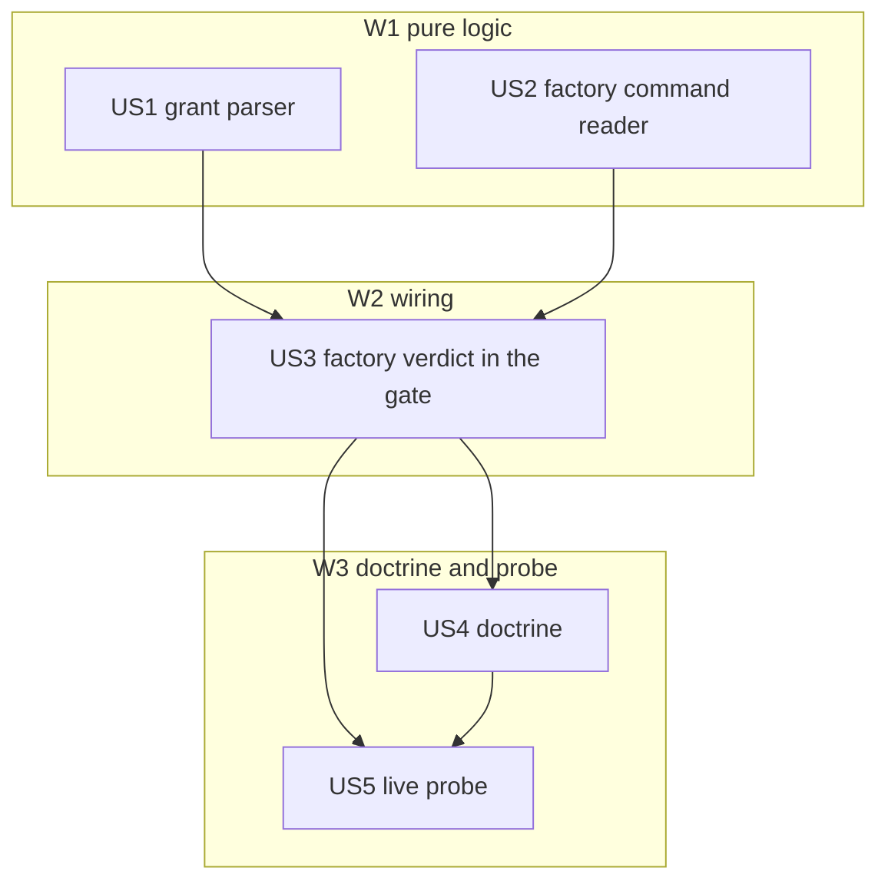

# Tasks index: factory mode for remote-git-gate

Level: Full — security gate (remote publishing), the spec names it High blast radius.
TDD-mode: forced for US1-US3 — `rules/test-policy.md` §Override: behaviour-changing HUs inside
`/flow-lifecycle` get `tdd: forced`; US4 is document-only (validations); US5 is a live probe.

## Resumen ejecutivo

Five HUs. W1 builds the two pure pieces in parallel: the grant parser (US1) and the factory
command reader (US2). W2 joins them in the hook verdict with its log (US3); this is the only HU
that changes runtime behaviour, and only when the env var is present. W3 writes the doctrine
(US4) and runs one live probe against a throwaway repo (US5, human checkpoint: creating a GitHub
repo is outward-facing).

Decisions absorbed from the spec: D1 merge denied only under a grant, D2 env var channel, D3
commits covered with hooks, D4 high-risk tickets excluded (enforced by the launcher in F3, not
here). New fact from research: `agent_id` is also set for a session started with `--agent`, so
the F3 launcher must not use `--agent` or every factory push is denied by `SUBAGENT_REASON`.

## Estimación de esfuerzo

| Wave | HUs | Esfuerzo | Naturaleza |
|---|---|---|---|
| W1 pure logic | US1, US2 | 90 min | parser + tokenizer reuse, table tests |
| W2 wiring | US3 | 60 min | hook verdict, log, entrypoint tests |
| W3 doctrine + probe | US4, US5 | 60 min | docs within budget, live probe |

**Critical path**: US2 → US3 → US5, ~150 min. Total budget 210 min, started 2026-10-26 09:14 CET.

## DAG

## Tabla resumen

| # | HU | Spec AC | Wave | Estimate | TDD-mode | Decisión absorbida |
|---|---|---|---|---|---|---|
| US1 | Grant parser from `PONEGLYPH_FACTORY` | AC6 (malformed) | W1 | S | forced | D2 |
| US2 | Factory command reader | AC1-AC4 (detection) | W1 | M | forced | D1 |
| US3 | Factory verdict, wiring and log | AC1-AC6 | W2 | M | forced | D1, D2 |
| US4 | Doctrine: Git rule, dudas.md, playbook, hooks rule | AC7, D3 | W3 | S | skip: document-only, covered by validations | D3, D4 |
| US5 | Live probe on a throwaway repo 🔴 | AC1, AC3, AC4 | W3 | S | skip: live probe, no code | none |

## Cross-cutting decisions

| Decisión | Dónde se toma | HUs afectadas | Criterio |
|---|---|---|---|
| Factory detection is separate from attended detection | US2 | US3 | AC6: attended verdicts must not change, so `gh pr ready` and `gh api …/merge` stay out of `remoteActions` |
| Grant beats attended asks | US3 | US4 | A chat order never widens a grant (spec §Gate changes) |
| CLAUDE.md net-zero bytes | US4 | — | Always-loaded ratchet: doctor row "15087 B ≤ snapshot" |

## Research

- Hooks inherit Claude Code's environment: "A hook process inherits the parent environment, apart
  from the `OTEL_*` exporter variables…" (code.claude.com/docs/en/hooks, fetched 2026-10-26). D2
  holds, except with `CLAUDE_CODE_SUBPROCESS_ENV_SCRUB=1` (not set in `settings.global.json`).
- Common input carries `cwd`, `agent_id`, `prompt_id`, `transcript_path` (same page).
- `agent_id` is set "for the subagent or in-process teammate … or the agent you chose with
  `--agent`" (same page).

## Preconditions for F3 (launcher)

- The target repo's base branch requires a review and admins cannot bypass it: the boundary when
  the hook does not fire or a script gets past it (D1, D6). Personal repos may lack it; the
  launcher refuses a repo without it.
- Every push URL of `origin` in the worktree is `https://github.com/<repo>` (D6): a repo cloned
  through an SSH alias gets its push URL set by the launcher, or every push is denied.
- No `--agent` at launch (index §Research).
- The kickoff prompt carries the limit from `docs/factory-mode.md`: the draft PR is the last step and
  the merge is never attempted, asked for or offered. `CLAUDE.md` does not load that doc, and the
  gate's denial alone teaches the limit only after an attempt.

## Open questions (deferidas a Fase 3)

1. `git push` with `-C <dir>`: honour `-C` when reading `@{push}` and the remote URL, or deny.
   Closed by D6: any global git option makes the push non-canonical, so it is denied with the
   exact command.

## Anti-patterns mitigation

| Anti-pattern | Cómo se evita |
|---|---|
| Widening attended behaviour by accident | US3 keeps the full existing suite unchanged as AC6 |
| Forgeable grant | Env of the `claude` process only; command-prefixed vars are ignored (US1 test) |

## Próximo paso

Phase 2.5 writes `tests.md` (US1-US3) and `validations.md` (US4-US5); tasks and oracle go to
gate 2→3 together.
