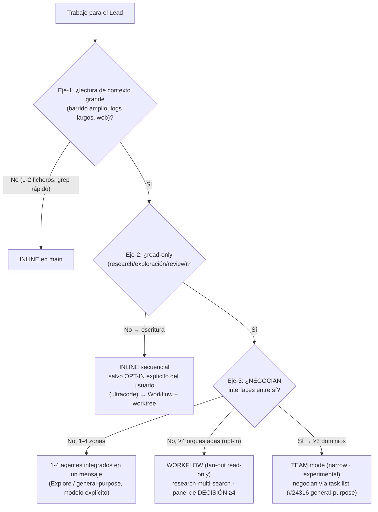

# Spawn decision tree: diagram

Resolve explicit consultation requests through the
[consultation route](../../../docs/harness-adapters.md#consultations) first. The diagram below
describes default native delegation. It does not override those explicit routes.
Permission and model choice remain owned by CLAUDE.md §Agents and skills.

The table of principles P1–P8 stays inline in `SKILL.md`; this diagram only renders it. Built-in agents need no approval (CLAUDE.md §Agents and skills).

Reading order: axis 1 asks whether the work means reading a large context (no → inline); axis 2 whether it is read-only (write fan-out needs explicit opt-in); axis 3 whether units negotiate interfaces (1–4 independent areas → built-in agents in one message, ≥4 orchestrated → Workflow, negotiating → Team mode).
